# FirstFrame

**Learn photography on a real camera, in your browser, before you own one.**

FirstFrame is a free, no-signup learning app built around a detailed 3D model of the **Canon EOS R100**, a typical first mirrorless camera. You can turn it over, press its buttons, open every door, swap lenses and take simulated photos. The app shows you why each picture came out the way it did.

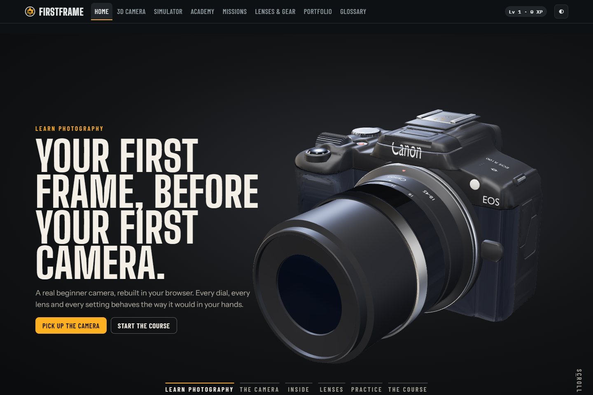

---

## Who it is for

- **You want a camera but have never used one.** Learn what aperture, shutter speed, ISO and focus do before you spend money.
- **You're deciding what to buy.** Hold a beginner body in 3D, look at every port and control, and try ten real lenses to see what each one is for.
- **You already have a camera.** Its buttons and menus confuse you, so practise here without wasting shots.
- **You teach photography.** Use it as a shared, free sandbox that every student can open without an account.

You don't need a camera, an account or an installation. Progress and photos stay in your own browser.

## What you can learn

| Before you buy, you'll understand... | Where |
|---|---|
| **The exposure triangle:** how aperture, shutter speed and ISO trade against each other | Simulator, Academy lessons 3–7 |
| **The shooting modes:** what Auto, P, Tv, Av and M actually do, and when to leave Auto | Simulator mode dial, lesson 8 |
| **Focus:** One-Shot vs Servo AF, AF points, manual focus and depth of field | Simulator Focus and Depth tabs, lessons 4 and 10 |
| **Metering and histograms:** why backlit faces go dark and how to fix them | Lesson 9, mission *Rescue the silhouette* |
| **White balance and picture styles**, and RAW vs JPEG | Lessons 11 and 15 |
| **Lenses:** focal length, crop factor, wide vs tele, primes vs zooms, and what each kit lens is good for | Lenses & Gear, 3D lens shelf, lesson 12 |
| **The physical camera:** every button, dial, door and port, using Canon's official names | 3D Camera |
| **Practical handling:** how the battery and SD card go in, what the ports are for, how an external flash mounts | 3D Camera |

## A tour of the app

### 3D Camera: hold the EOS R100 in your hands
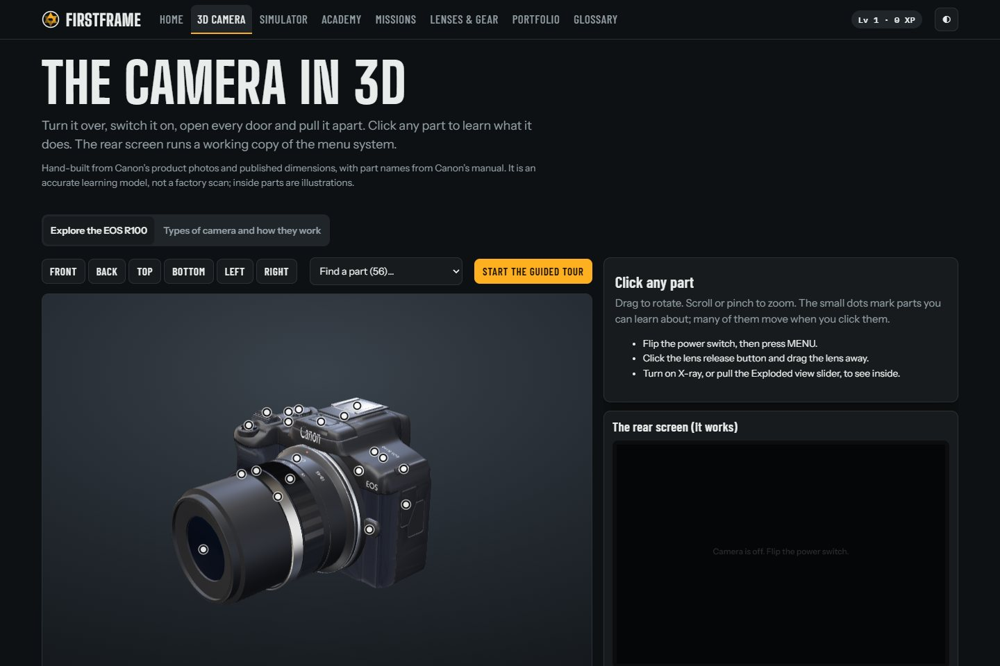

- **Rotate, zoom and click any of 57 parts.** Each has its official Canon name, a plain-language explanation, what is printed on it, and a link to the matching lesson. Selected parts glow, and the camera turns to face them.
- **Press the real controls.** Flip the power switch, turn the mode dial, raise the built-in flash, press MENU and work the four cross keys. The **rear screen runs a working copy of the camera's menu**, and changes you make there change the camera everywhere in the app.
- **Open every door:**
  - **Terminal covers:** the real sockets are behind them: USB-C, micro-HDMI, a 3.5 mm microphone jack and the remote-switch jack.
  - **Card/battery door:** take the **LP-E17 battery** and the **SD card** right out. Guides show which way each goes back in: contacts first for the battery; label to the front for the card.
- **Add a Speedlite EL-100** to the hot shoe, tilt its head for bounce flash, and watch it fire with the shutter.
- **X-ray and exploded views** show the sensor, shutter and inside parts.
- **Detach the lens** to see the sensor and mount, then drag any of the **ten lenses** onto the camera. The zoom ring turns and the iris opens and closes with the f-number.

| Ports behind the covers | Battery and SD card out of the camera | Speedlite on the hot shoe |
|---|---|---|
| 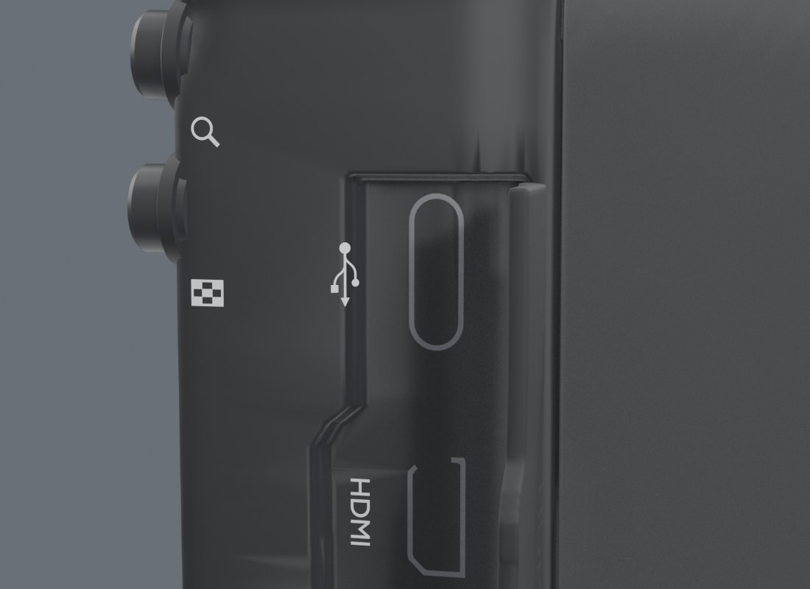 | 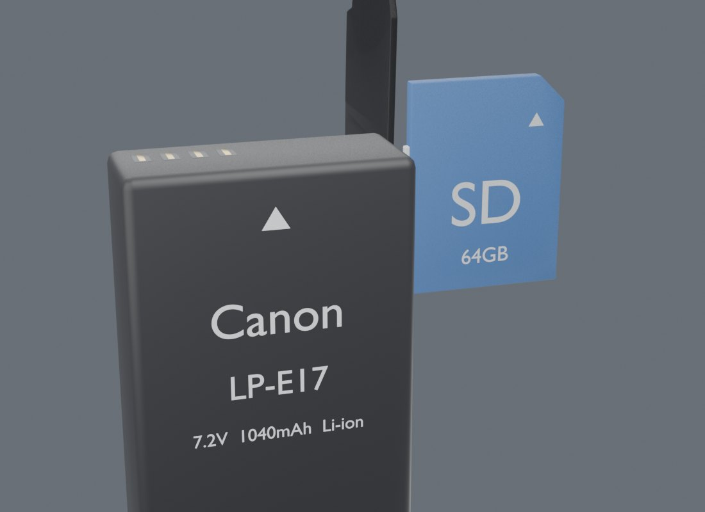 | 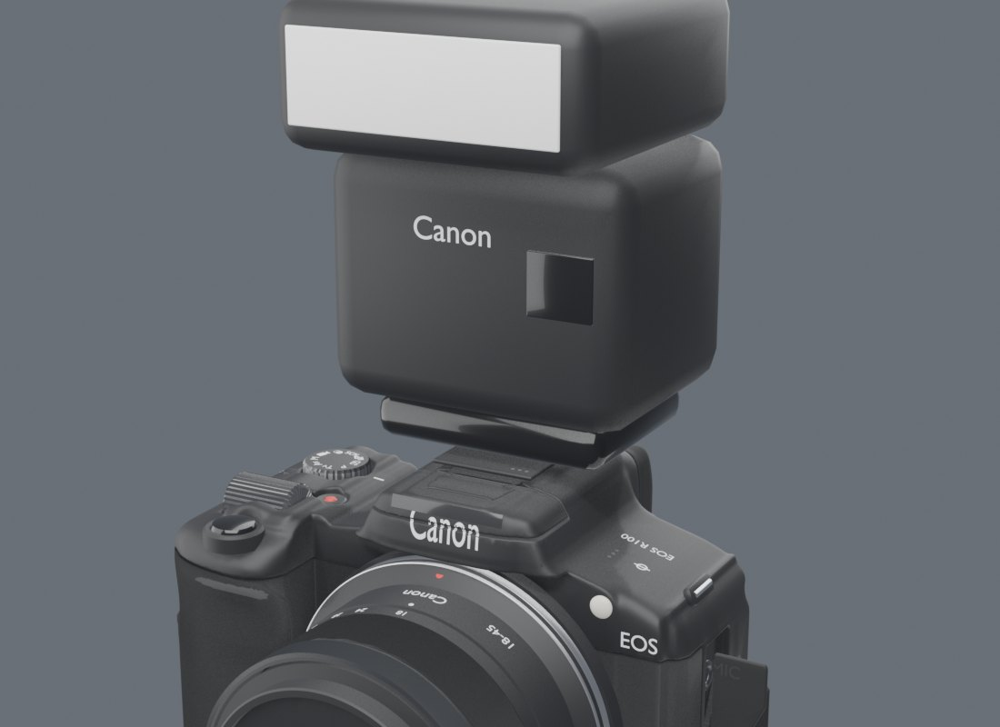 |
| 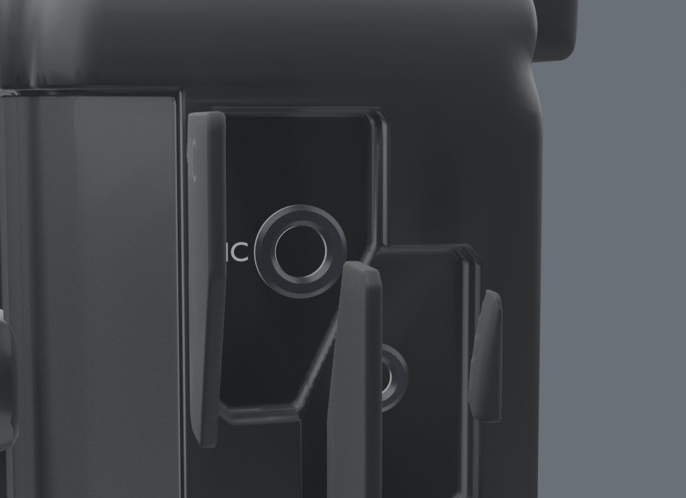 | 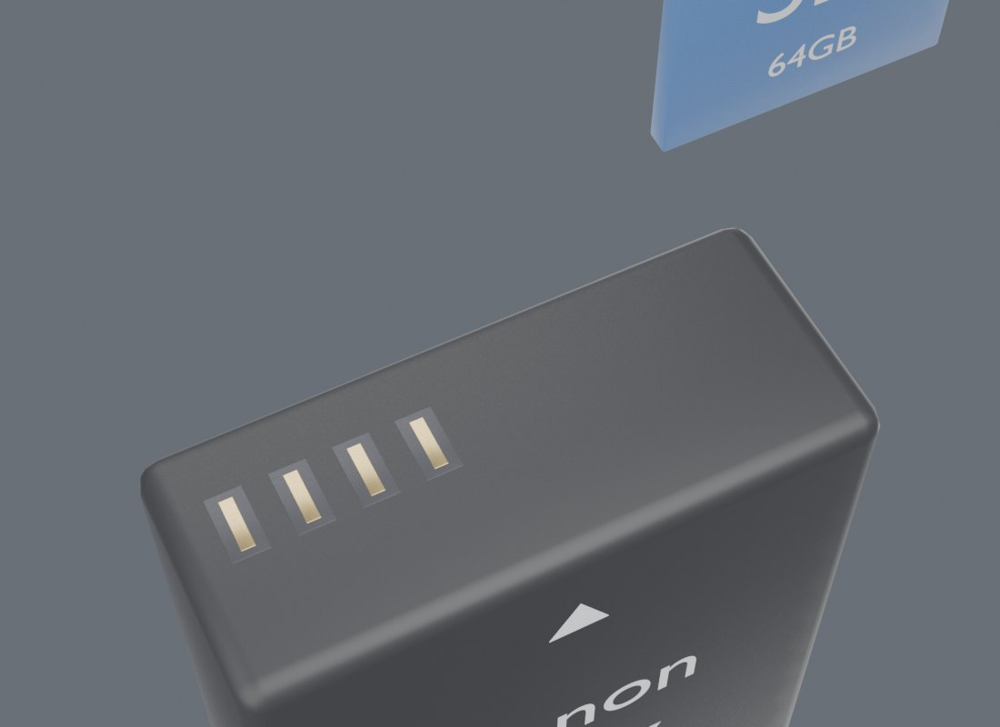 | 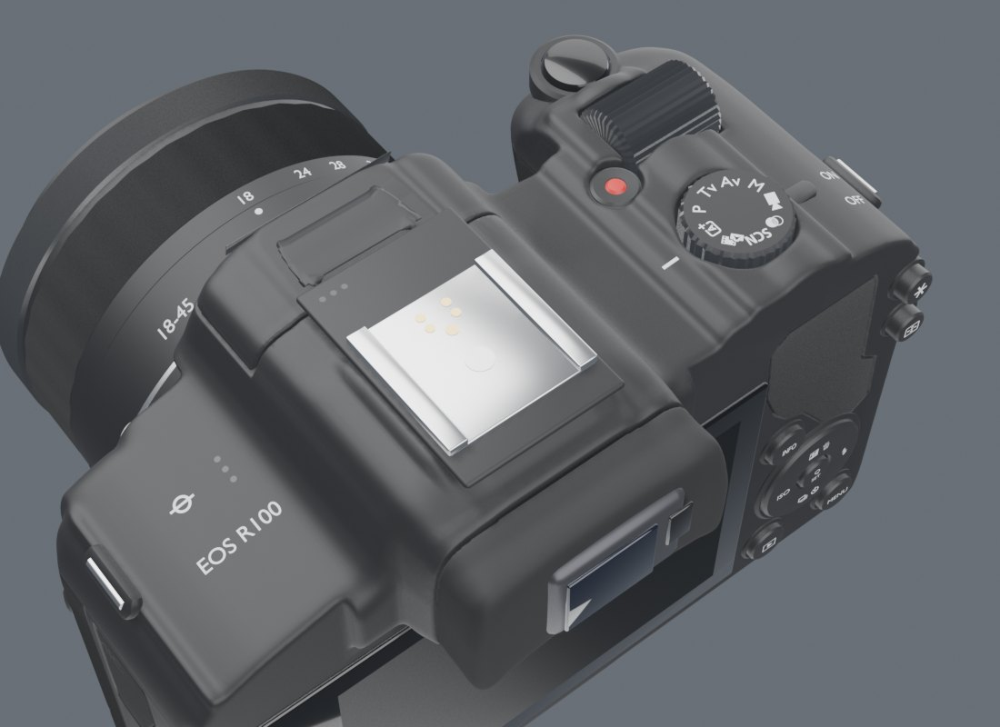 |

### Simulator: take pictures and see the result
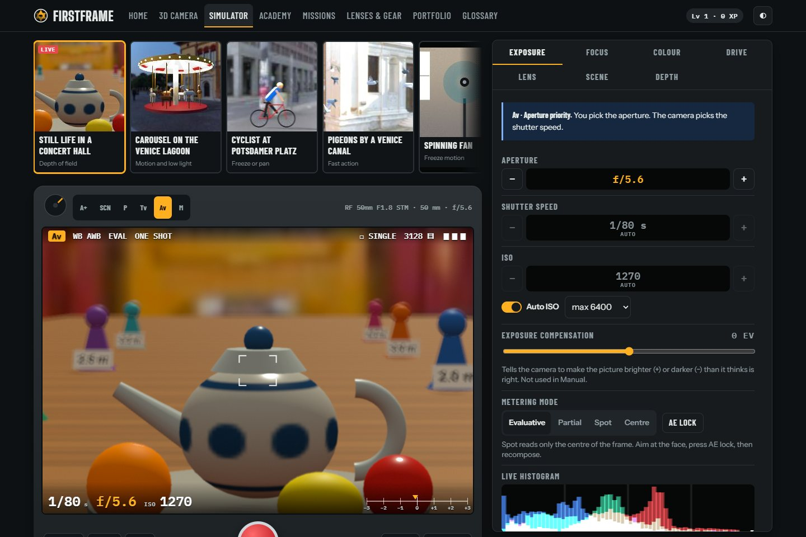

- **Eleven scenes**, each built to teach something. They include a spinning fan, a waterfall, a passing car, a candlelit table, a night street, a golden-hour portrait, and 3D scenes in a concert hall, on a Venice lagoon and at Potsdamer Platz.
- **A real viewfinder** with live exposure readouts and a live histogram. Click to place the AF point; half-press to focus.
- **Every setting a beginner needs:**
  - **Exposure:** mode, aperture, shutter speed, ISO and Auto ISO, exposure compensation, metering, AE lock.
  - **Focus:** focus mode, AF area and face detection.
  - **Colour:** white balance and picture style.
  - **Shooting:** drive mode, flash and stabilisation.
  - **Lens:** lens choice and zoom.
- **The photo shows the physics.** Motion blur comes from your shutter speed, background blur from your aperture and distance, grain from ISO, and blown highlights from over-exposure. Each shot gets an analysis that says what went right and what to change.

### Academy: 15 short lessons
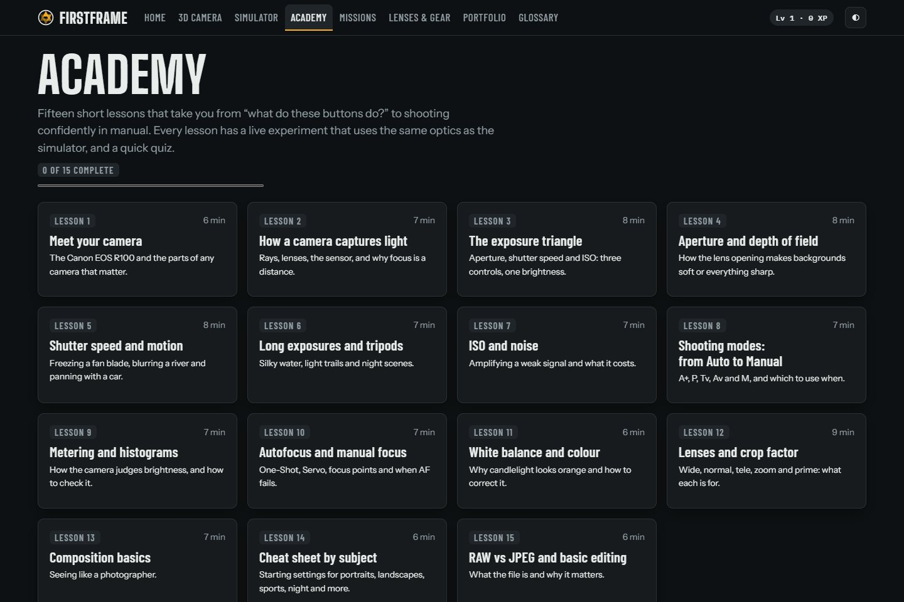

1. Meet your camera
2. How a camera captures light
3. The exposure triangle
4. Aperture and depth of field
5. Shutter speed and motion
6. Long exposures and tripods
7. ISO and noise
8. Shooting modes: from Auto to Manual
9. Metering and histograms
10. Autofocus and manual focus
11. White balance and colour
12. Lenses and crop factor
13. Composition basics
14. Cheat sheet by subject
15. RAW vs JPEG and basic editing

Each lesson has an interactive lab that changes one thing at a time, so you see cause and effect, plus a short quiz.

### Missions: 9 photo challenges
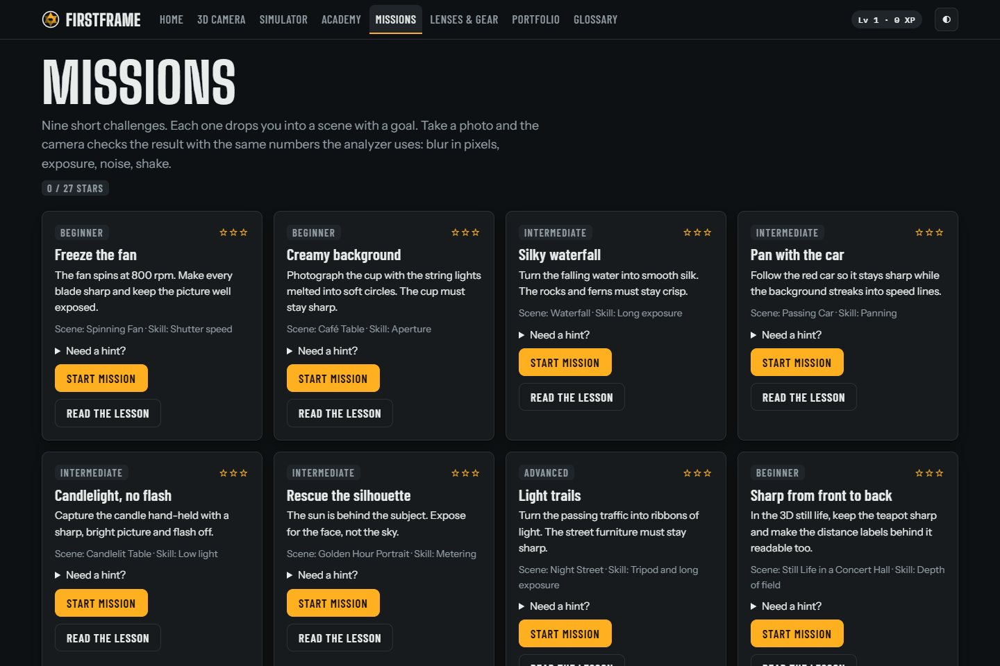

*Freeze the fan · Creamy background · Silky waterfall · Pan with the car · Candlelight, no flash · Rescue the silhouette · Light trails · Sharp from front to back · Pan with the cyclist*

Each mission drops you into a scene with a goal. Your photo is scored against clear criteria (blur, exposure, noise, focus) for up to three stars, with hints if you get stuck.

### Lenses & Gear: what the camera can and can't do
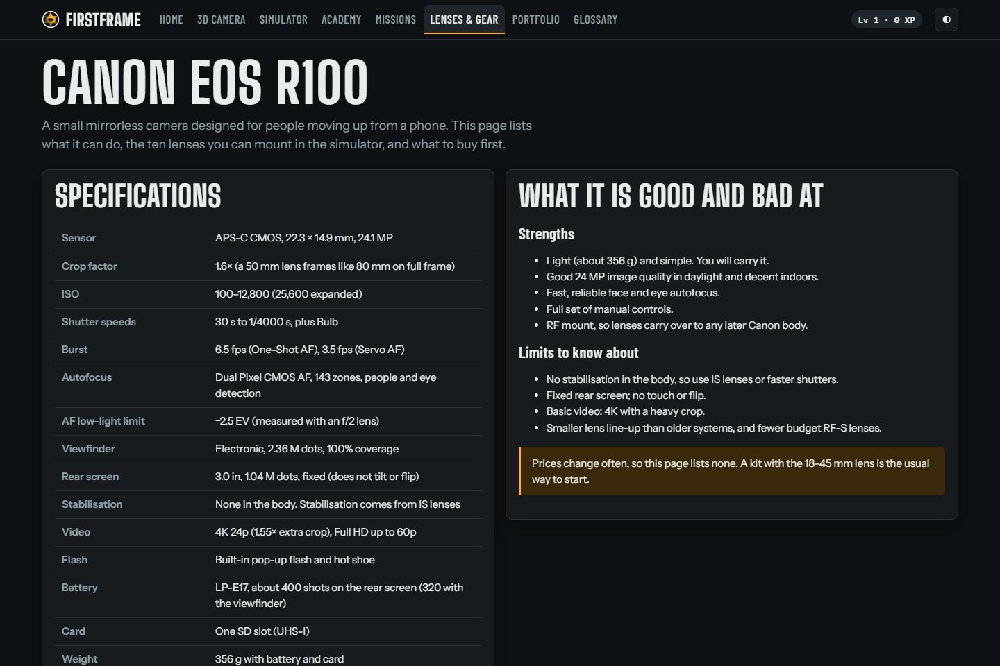

The R100's specifications in plain words, what it is good and bad at, and ten lenses explained by what they are *for*:

| Lens | Role |
|---|---|
| RF-S 18-45mm F4.5-6.3 IS STM | the kit lens |
| RF 50mm F1.8 STM | the first upgrade |
| RF-S 55-210mm F5-7.1 IS STM | reach for sport and wildlife |
| RF-S 10-18mm F4.5-6.3 IS STM | ultra-wide |
| RF-S 18-150mm F3.5-6.3 IS STM | one lens for everything |
| RF 16mm F2.8 STM | small bright wide prime |
| RF 28mm F2.8 STM | pancake |
| RF 35mm F1.8 MACRO IS STM | bright normal lens with close focus |
| RF 85mm F2 MACRO IS STM | portraits |
| RF 100-400mm F5.6-8 IS USM | birds and distant action |

### Glossary and Portfolio
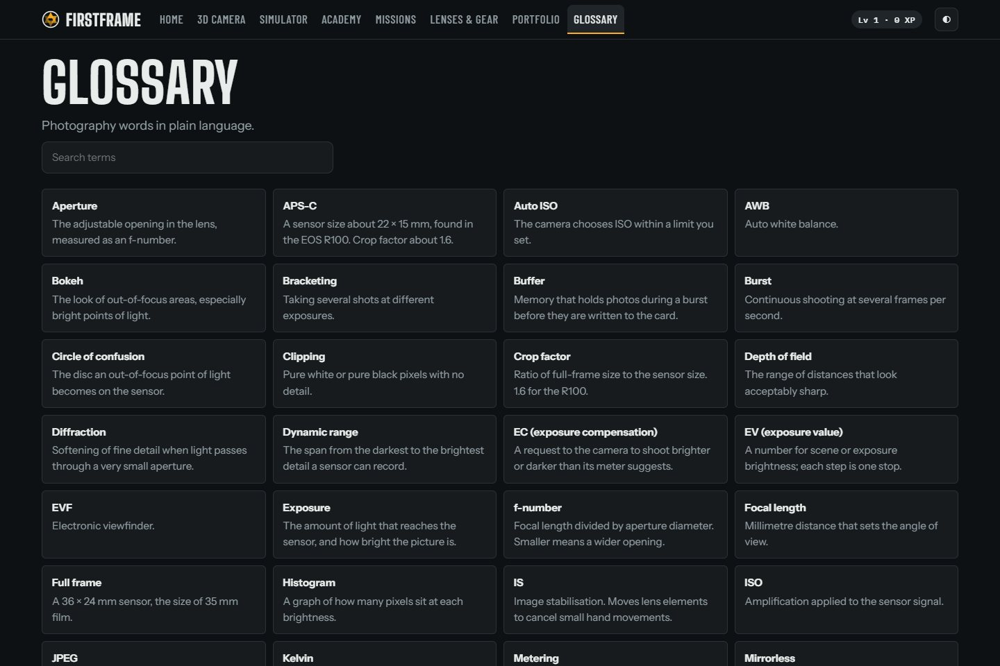

- **Glossary:** 40 photography words in plain language, searchable.
- **Portfolio:** your simulated photos, kept in your browser, with their settings and feedback.

## A suggested path if you're thinking of buying a camera

1. **3D Camera:** take the guided tour, so you know what each button is called and where it is.
2. **Academy lessons 1–3:** learn the exposure triangle.
3. **Simulator in Av mode:** shoot the *Golden Hour Portrait* at f/4.5 and then f/11, and compare the background.
4. **Simulator in Tv mode:** shoot the *Spinning Fan* at 1/30 s and then 1/1000 s.
5. **Missions** *Freeze the fan*, *Creamy background* and *Candlelight, no flash*: these are the situations that make people upgrade from a phone.
6. **Lenses & Gear:** with what you now know, decide whether the kit lens is enough or whether a 50 mm f/1.8 or a telephoto fits how you want to shoot.
7. **3D Camera again:** take the battery and card out, open the ports and add a flash, so nothing is a surprise on day one.

---

## Run it yourself

FirstFrame is a static site: plain HTML, CSS and JavaScript, with no build step. The 3D model is loaded over HTTP, so serve the folder instead of opening `index.html` from disk.

```bash
git clone https://github.com/perumallavishnu/FirstFrame.git
```

```bash
cd FirstFrame
```

```bash
python -m http.server 8765 --bind 127.0.0.1
```

Then open **http://localhost:8765** in a recent Chrome, Edge, Firefox or Safari. Any static server works, for example `npx serve .`.

**Requirements:**
- A browser with WebGL 2.
- An internet connection on first load, for Three.js, the Draco decoder and the web fonts, which come from jsDelivr and Google Fonts.

On phones and devices with 4 GB of memory or less, a lighter 3D model loads automatically. Add `?lod=mobile` or `?lod=desktop` to the URL to force one.

### Tests and checks

These need Node.js 18 or newer and no packages.

```bash
node --test tests/camera.test.js
```

```bash
node scripts/validate-camera-profile.js
```

- **The tests (13)** cover the exposure maths and the camera rules: Av, Tv and M behaviour, exposure compensation, lens aperture limits, the flash sync speed, and that every control path changes the same camera state.
- **The validator** checks that every part in the registry has its mesh and hotspot anchor in both 3D model files.

## How it is built

| Area | Files |
|---|---|
| App shell, routing, pages | `index.html`, `js/app.js`, `js/pages.js`, `js/landing.js`, `css/*.css` |
| Camera state, exposure solver, autofocus | `js/cam_core.js`, `js/physics.js`, `js/params.js` |
| **One action dispatcher for every control** | `js/cam_actions.js` ([docs](docs/CAMERA_ACTIONS.md)) |
| Image renderer (WebGL2) and scenes | `js/gl_*.js`, `js/render*.js`, `js/scenes3d.js` |
| Simulator UI, viewfinder, rear-screen menu | `js/sim_ui.js`, `js/sim_view.js`, `js/menu.js` |
| Lessons, labs, missions, glossary | `js/lessons*.js`, `js/labs.js`, `js/missions.js`, `js/analyze.js` |
| 3D viewer and GLB adapter | `js/cam3d.js`, `js/cam3d_glb.js`, fallback `js/cam3d_model.js` |
| **Camera profile: 57 parts with Canon's names and sources** | `js/camera/eos_r100_profile.js` |
| 3D models (Draco GLB) | `assets/models/canon-eos-r100/Canon_EOS_R100.glb`, `..._mobile.glb` |
| Blender source and build pipeline | `blender/eos-r100/` (`Canon_EOS_R100.blend`, `build_*.py`, `tools/`) |

**Tech:** vanilla JavaScript (no framework), Three.js r160 as ES modules, WebGL2, Blender 5.2 for the model, and browser storage only. There's no server, database or tracking.

### The 3D model

The camera isn't modelled by eye. Its shell is a **visual hull** of six of Canon's product photos (front, back, top, bottom and both sides), each scaled to Canon's published size of 116.3 × 85.5 × 68.8 mm. Every control was then measured from the photos and placed on the real surface.

- **Shape match:** the model's outline matches Canon's photos at 93–97% in every view.
- **Lenses:** each lens profile is read from Canon's side photo, and seven of them match Canon's published lengths to within 1 mm.
- **Connectors:** sockets, battery and card follow the published standards. USB-C has an 8.34 × 2.56 mm opening, micro-HDMI is 6.4 × 2.8 mm, and the LP-E17 battery is 33.0 × 14.0 × 49.4 mm.

The full write-up is in **[docs/R100_MODEL_REPORT.md](docs/R100_MODEL_REPORT.md)**: method, accuracy tables, known approximations and how to rebuild.

Rebuilding the model needs Blender 5.2, plus Python 3 with numpy, scipy and Pillow:

```bash
python -I blender/eos-r100/tools/fetch_refs.py
```

That downloads Canon's reference photos, which are not in this repo because they're Canon's copyright. Then follow the steps in the report: `masks.py` → `hull.py` → `sdf_to_mesh.py` → `build_r100.py` → `export_glb.py`.

### Adding more cameras

The method is written up as a Claude Code skill in **[.claude/skills/camera-model-builder/](.claude/skills/camera-model-builder/SKILL.md)**. It covers:
- **sourcing** official photos and manuals;
- **calibration** and the visual hull;
- **placing parts** and markings;
- **building lenses, connectors, battery and card** to their published dimensions;
- **the accuracy gates** every camera must pass (size within 1 mm, outline match of at least 92% in every view);
- **adding the camera** to the app as a new profile.

In a Claude Code session in this repo, ask for a camera by name (for example "add the Nikon Z50 II") and the skill takes it from there.

## Accuracy and honesty

- **This is a learning simulator, not the real camera.** Exposure, depth of field, motion blur, noise and autofocus follow real optics and are good enough to learn from. Image quality, autofocus speed and menu depth are simplified.
- **Only some modes are simulated.** P, Tv, Av, M, A+ and three scene modes work. Hybrid Auto, creative filters and movie mode are explained rather than simulated.
- **Approximate parts are marked as approximate:**
  - The access lamp, the DC cord hole, and which holes are the microphone vs the speaker are placed from Canon's diagrams.
  - The RF 85 mm and RF 100-400 mm lenses are built from published sizes, because no Canon product photos were available.
  - The inside of the camera is an illustration.
- **Sources:** each specification and part name links to Canon's manual or specification pages.

## Privacy

There's no account, sign-up, analytics or tracking. Lesson progress, mission stars and your photos are saved only in your browser's local storage. Clearing your browser data removes them.

## Credits

- **Not made by or affiliated with Canon Inc.** Canon, EOS, Speedlite and RF are trademarks of Canon Inc., and are used here only to describe real equipment. The 3D model uses plain type, not the Canon logo.
- **Reference material** came from Canon's EOS R100 Advanced User Guide and Canon product pages. It's used to build the model and is not redistributed here.
- **Blender skill pack:** [arjun988/blender-skills](https://github.com/arjun988/blender-skills) (MIT), in `.claude/skills/`.
- **Three.js:** [threejs.org](https://threejs.org) (MIT).

## Licence

No licence has been chosen yet, so all rights are reserved by the author for now. Open an issue if you'd like to use or contribute to the project.
