<p align="center">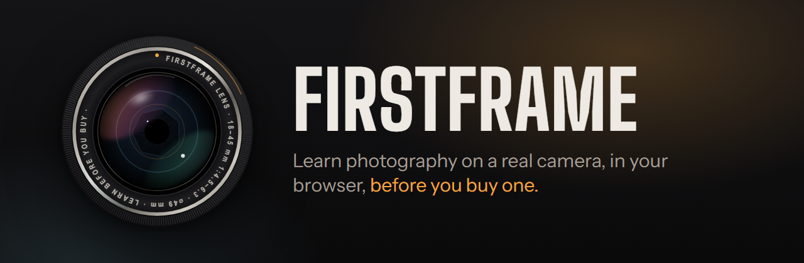</p>

<p align="center">
  <a href="https://firstframe-phi.vercel.app"><b>Open FirstFrame</b></a> ·
  <a href="#a-tour-of-the-app">Tour</a> ·
  <a href="#run-it-yourself">Run it yourself</a> ·
  <a href="#adding-more-cameras">Add a camera</a>
</p>

FirstFrame is a free, no-signup photography school built around a photo-accurate 3D **Canon EOS R100**, a typical first mirrorless camera. You can:
- turn the camera over, press its buttons and open every door;
- take the battery and card out and swap between ten lenses;
- shoot simulated photos, and the app explains why each one came out the way it did.

Everything runs in your browser. There's no account, no install and no tracking.

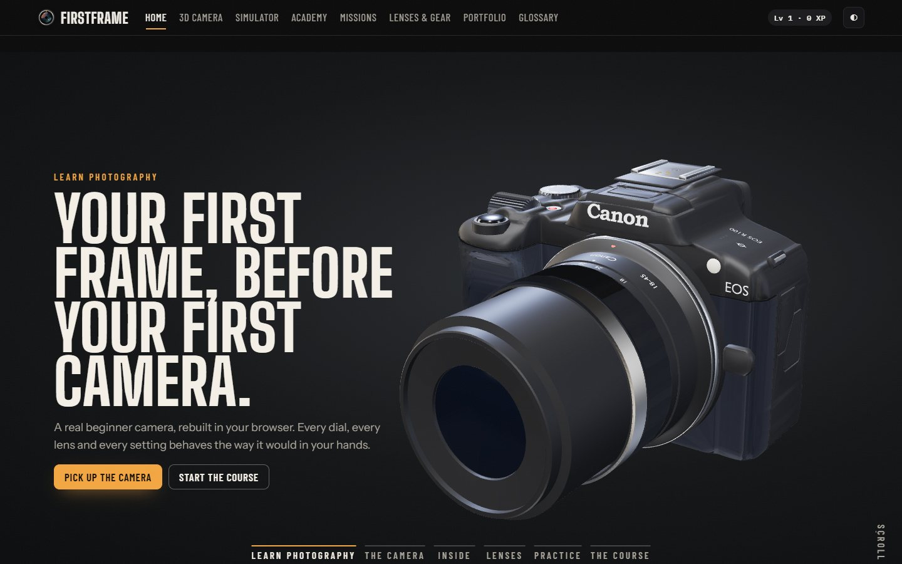

---

## What's new
- **A cinematic look.** The palette borrows from a film set: stage black, warm silver-halide text and one tungsten accent, with a cool daylight rim light on the 3D stage, a fine film grain and a light theme behind the toggle. Details are in [DESIGN.md](DESIGN.md).
- **A lens rail beside the camera.** All ten lenses sit in a reel on the left of the 3D view. Scroll over it to roll through them; the lens in the middle is large and lit, and its neighbours fade away. Drag a lens onto the camera or click to place it. On phones the rail becomes a swipeable strip under the camera.
- **Smooth, fast scrolling.** Lenis on GSAP's clock, with themed scrollbars. Panels, the lens rail and 3D zoom keep their own scrolling, and visitors who ask for reduced motion get plain scrolling.
- **A new logo and favicon.** A camera lens seen from the front: rubber ribbing, a machined metal ring, coated glass and the site's tungsten key light. It also comes as a web-app icon.
- **A more accurate model.** The Canon wordmark is sized to Canon's photo, and the flash-head seam follows the real curve. There are real sockets behind the covers, the battery and SD card come fully out, and an optional Speedlite EL-100 sits on the hot shoe.
- **Ready for more cameras.** There's a step-by-step skill for modelling any camera to the same accuracy, plus fill-in-the-name research prompts (see [Adding more cameras](#adding-more-cameras)).

## Who it is for
- **You want a camera but have never used one.** Learn what aperture, shutter speed, ISO and focus do before you spend money.
- **You're deciding what to buy.** Hold a beginner body in 3D, look at every port and control, and try ten real lenses to see what each one is for.
- **You already have a camera.** If its buttons and menus confuse you, practise here without wasting shots.
- **You teach photography.** Use it as a free shared sandbox that every student can open without an account.

You don't need a camera, an account or an installation. Progress and photos stay in your own browser.

## What you'll understand before you buy

| Topic | Where |
|---|---|
| **The exposure triangle:** how aperture, shutter speed and ISO trade against each other | Simulator, Academy lessons 3–7 |
| **The shooting modes:** what Auto, P, Tv, Av and M really do, and when to leave Auto | Simulator mode dial, lesson 8 |
| **Focus:** One-Shot vs Servo AF, AF points, manual focus and depth of field | Simulator Focus and Depth tabs, lessons 4 and 10 |
| **Metering and histograms:** why backlit faces go dark and how to fix them | Lesson 9, mission *Rescue the silhouette* |
| **White balance, picture styles, and RAW vs JPEG** | Lessons 11 and 15 |
| **Lenses:** focal length, crop factor, wide vs tele, primes vs zooms | Lens rail, Lenses & Gear, lesson 12 |
| **The physical camera:** every button, dial, door and port, with Canon's official names | 3D Camera |
| **Handling:** how the battery and SD card go in, what the ports are for, how a flash mounts | 3D Camera |

## A tour of the app

### 3D Camera: hold the EOS R100
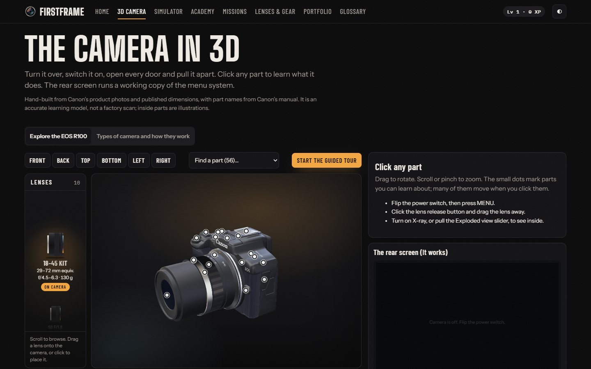

- **Rotate, zoom and click any of 57 parts.** Each part has:
  - its official Canon name;
  - a plain-language explanation;
  - what is printed on it;
  - a link to the matching lesson.

  The camera turns to face the part you pick, and a guided tour walks through them in order.
- **Press the real controls.** Flip the power switch, turn the mode dial, raise the flash, press MENU and use the cross keys. The **rear screen runs a working copy of the camera's menu**, and changes there apply everywhere in the app.
- **Choose a lens from the rail.** Roll the reel, then drag the focused lens onto the mount. The zoom ring turns, and the iris opens and closes with the f-number. Click the lens release button to take it off again.
- **Open every door:**
  - **Terminal covers:** USB-C, micro-HDMI, a 3.5 mm microphone jack and the remote jack, modelled to their real connector sizes.
  - **Card and battery door:** take the **LP-E17 battery** and the **SD card** right out. Guides show which way each goes back in.
- **Add a Speedlite EL-100** to the hot shoe, tilt it for bounce flash, and watch it fire with the shutter.
- **See inside:** X-ray and exploded views show the sensor, shutter and internal parts.

| Ports behind the covers | Battery and SD card out | Speedlite on the hot shoe |
|---|---|---|
| 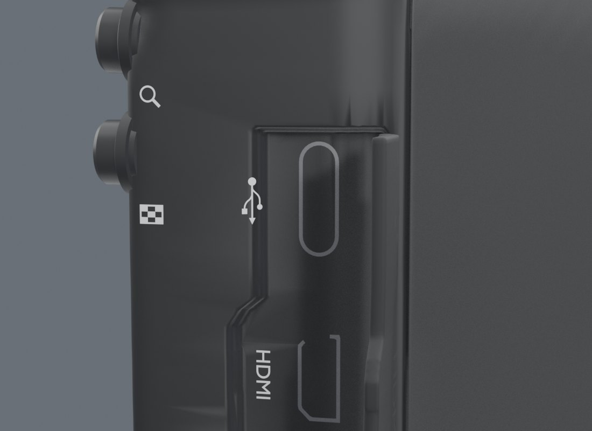 | 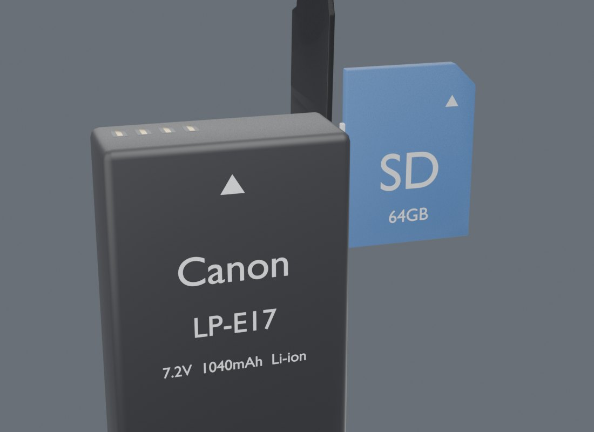 | 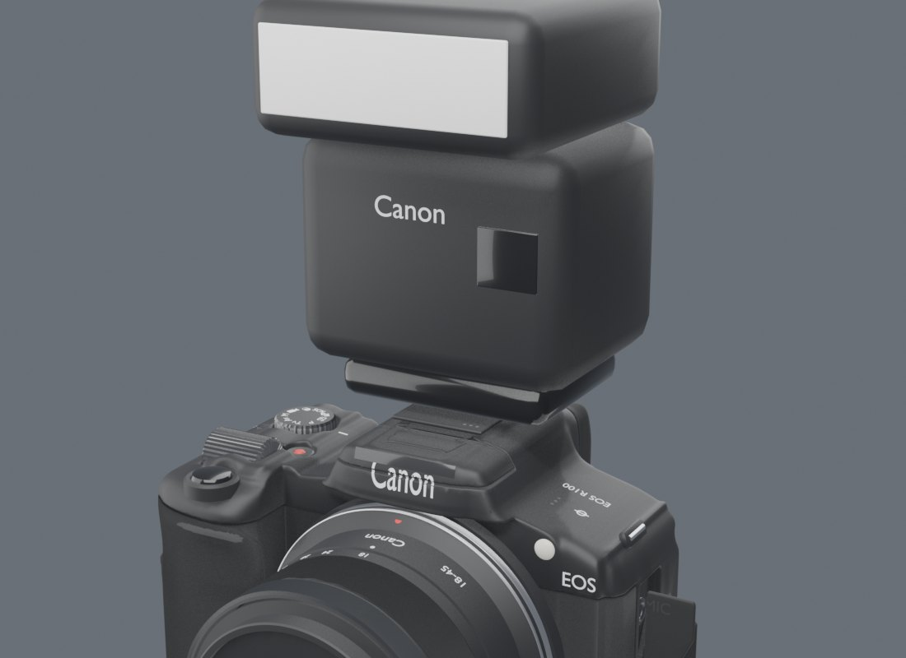 |
| 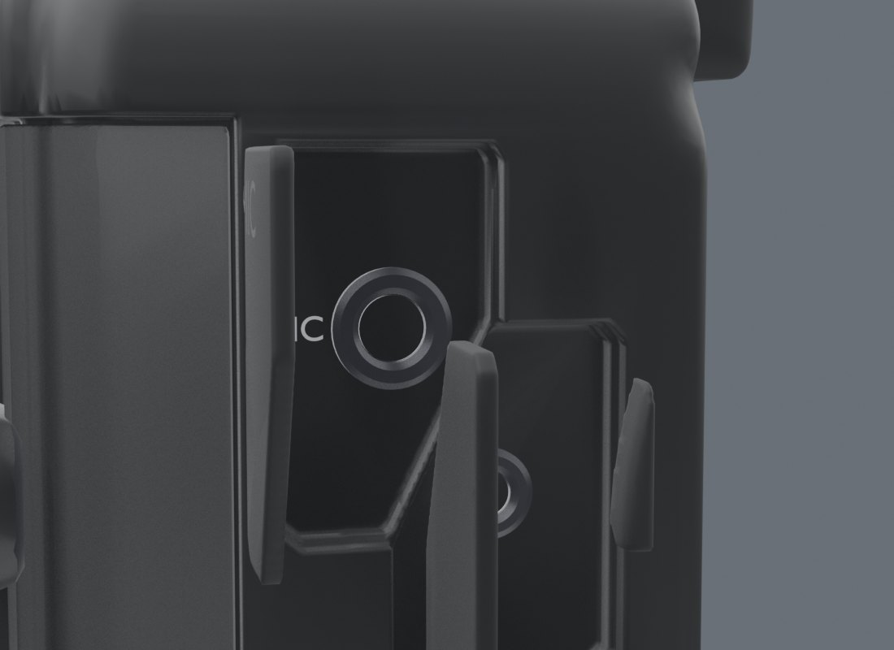 | 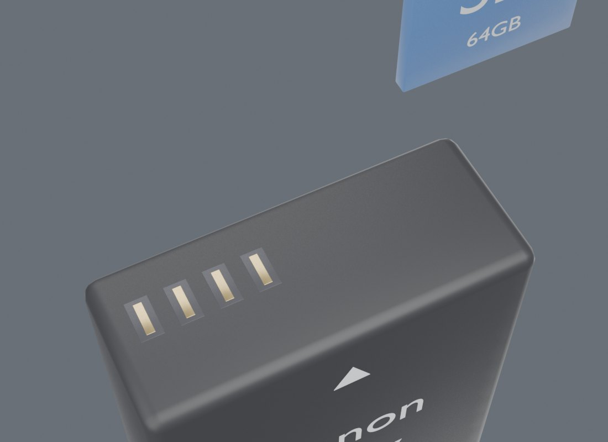 | 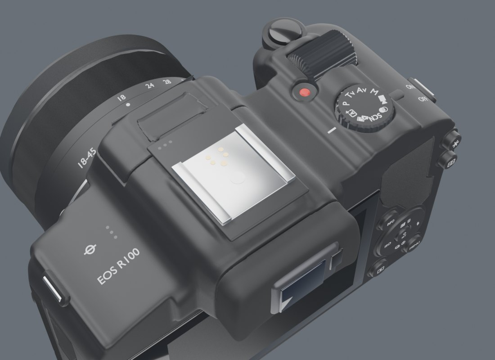 |

### Simulator: take pictures and see why they look that way
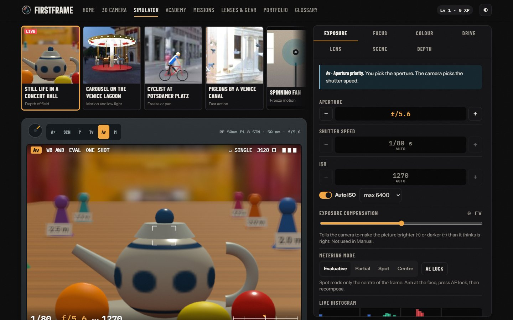

- **Eleven scenes, each built to teach something.** They include a spinning fan, a waterfall, a passing car, a candlelit table and a night street, plus 3D scenes in a concert hall, on a Venice lagoon and at Potsdamer Platz.
- **A real viewfinder:** live exposure readouts and a live histogram. Click to place the AF point, and half-press to focus.
- **Every setting a beginner needs:** mode, aperture, shutter, ISO and Auto ISO, exposure compensation, metering, AE lock, focus mode, AF area, white balance, picture style, drive, flash, stabilisation and zoom.
- **The photo follows the physics.**
  - Motion blur comes from your shutter speed.
  - Background blur comes from your aperture and distance.
  - Grain comes from ISO.
  - Highlights blow out when you over-expose.

  Each shot gets an analysis of what went right and what to change.

### Academy: 15 short lessons
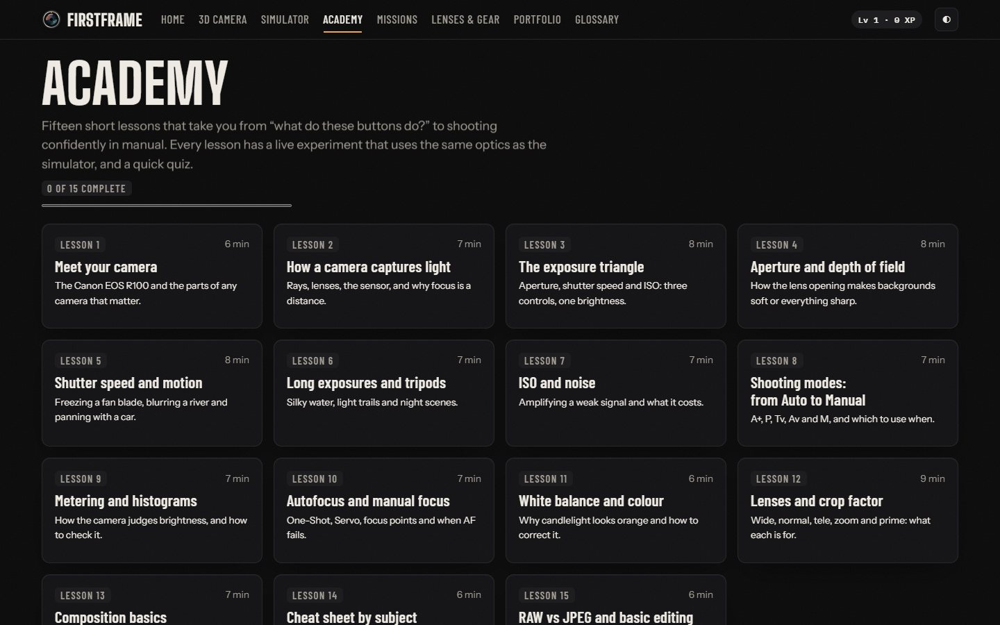

1. Meet your camera
2. How a camera captures light
3. The exposure triangle
4. Aperture and depth of field
5. Shutter speed and motion
6. Long exposures and tripods
7. ISO and noise
8. Shooting modes: from Auto to Manual
9. Metering and histograms
10. Autofocus and manual focus
11. White balance and colour
12. Lenses and crop factor
13. Composition basics
14. Cheat sheet by subject
15. RAW vs JPEG and basic editing

Each lesson has an interactive lab that changes one thing at a time, so you see cause and effect, plus a short quiz.

### Missions: 9 photo challenges
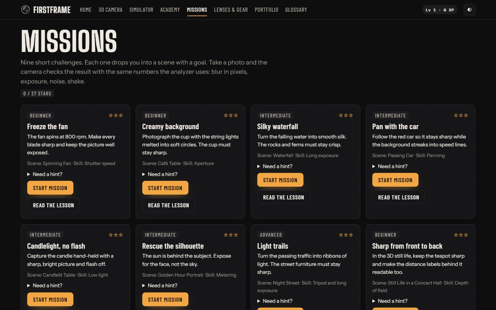

*Freeze the fan · Creamy background · Silky waterfall · Pan with the car · Candlelight, no flash · Rescue the silhouette · Light trails · Sharp from front to back · Pan with the cyclist*

Each mission drops you into a scene with a goal. Your photo is scored on blur, exposure, noise and focus for up to three stars, with hints if you get stuck.

### Lenses & Gear: what the camera can and can't do
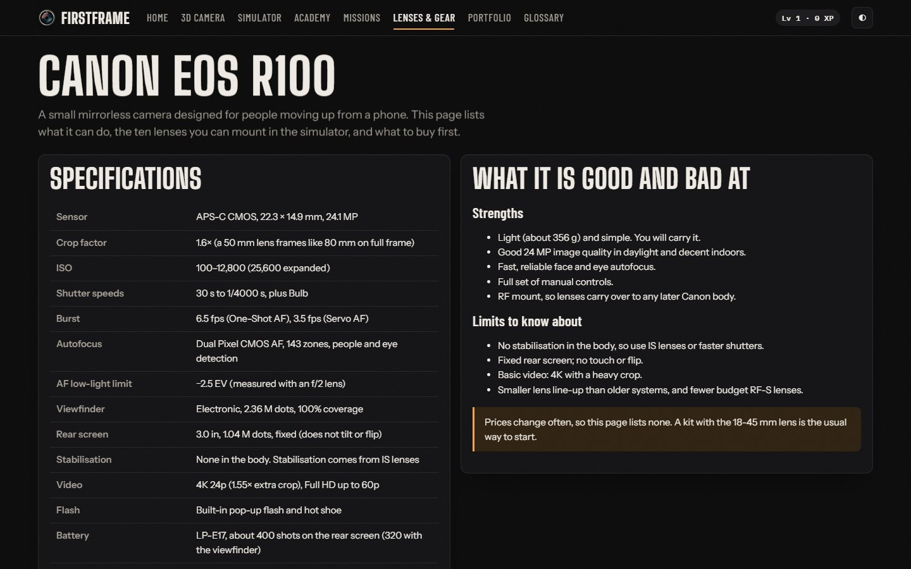

This page covers the R100's specifications in plain words, what it is good and bad at, and ten lenses explained by what they are *for*:

| Lens | Role |
|---|---|
| RF-S 18-45mm F4.5-6.3 IS STM | the kit lens |
| RF 50mm F1.8 STM | the first upgrade |
| RF-S 55-210mm F5-7.1 IS STM | reach for sport and wildlife |
| RF-S 10-18mm F4.5-6.3 IS STM | ultra-wide |
| RF-S 18-150mm F3.5-6.3 IS STM | one lens for everything |
| RF 16mm F2.8 STM | small, bright, wide prime |
| RF 28mm F2.8 STM | pancake |
| RF 35mm F1.8 MACRO IS STM | bright normal lens with close focus |
| RF 85mm F2 MACRO IS STM | portraits |
| RF 100-400mm F5.6-8 IS USM | birds and distant action |

### Glossary and Portfolio
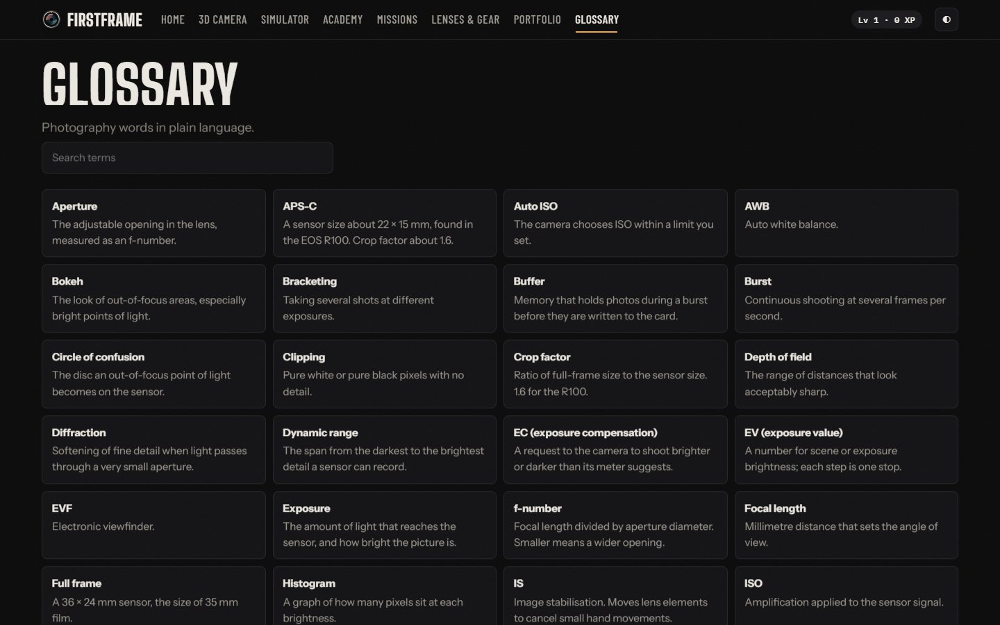

- **Glossary:** 40 photography words in plain language, searchable.
- **Portfolio:** your simulated photos, kept in your browser with their settings and feedback.

### On tablets and phones
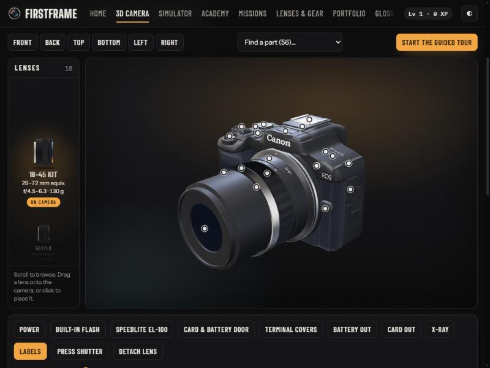

The layout is redesigned for smaller screens, not just squeezed:
- **Tablets:** the info and rear-screen cards move below the camera.
- **Phones:** the lens rail becomes a swipe strip.
- **Lighter model:** phones and low-memory devices get a lighter 3D model automatically.

## A path if you're thinking of buying a camera
1. **3D Camera:** take the guided tour, so you know what each button is called and where it is.
2. **Academy lessons 1–3:** learn the exposure triangle.
3. **Simulator in Av mode:** shoot the *Golden Hour Portrait* at f/4.5 and then f/11, and compare the backgrounds.
4. **Simulator in Tv mode:** shoot the *Spinning Fan* at 1/30 s and then 1/1000 s.
5. **Missions:** try *Freeze the fan*, *Creamy background* and *Candlelight, no flash*. These are the situations that make people upgrade from a phone.
6. **Lens rail and Lenses & Gear:** decide whether the kit lens is enough, or whether a 50 mm f/1.8 or a telephoto fits how you want to shoot.
7. **3D Camera again:** take the battery and card out, open the ports and add a flash, so nothing surprises you on day one.

---

## Run it yourself
FirstFrame is a static site: plain HTML, CSS and JavaScript with no build step. Serve the folder rather than opening `index.html` from disk, because the 3D model loads over HTTP.

```bash
git clone https://github.com/perumallavishnu/FirstFrame.git
```

```bash
cd FirstFrame
```

```bash
python -m http.server 8765 --bind 127.0.0.1
```

Then open **http://localhost:8765** in a recent Chrome, Edge, Firefox or Safari. Any static server works, for example `npx serve .`.

**Requirements:**
- A browser with WebGL 2.
- An internet connection on first load. Three.js, the Draco decoder, GSAP and Lenis come from jsDelivr or cdnjs, and the fonts from Google Fonts.

To force a 3D model size, add `?lod=mobile` or `?lod=desktop` to the URL.

### Deploy
The live site is a static deploy on Vercel. [`.vercelignore`](.vercelignore) keeps Canon's reference photos, the Blender source and the build tools off the public site.

```bash
npx vercel deploy --prod
```

### Tests and checks
These need Node.js 18 or newer, with no packages.

```bash
node --test tests/camera.test.js
```

```bash
node scripts/validate-camera-profile.js
```

- **Tests (13):** the exposure maths and the camera rules. They cover Av, Tv and M behaviour, exposure compensation, lens aperture limits and flash sync, and check that every control path changes the same camera state.
- **Validator:** checks that every registered part has its mesh and hotspot anchor in both 3D model files.

## How it is built

| Area | Files |
|---|---|
| App shell, routing, pages | `index.html`, `js/app.js`, `js/pages.js`, `js/landing.js` |
| **Theme and motion** | `css/theme.css` (palette, grain, scrollbars, reveals), `js/smooth.js` (GSAP clock + Lenis), [DESIGN.md](DESIGN.md) |
| **Brand** | `assets/brand/lens-logo.svg`, `favicon.svg`, `icon-*.png`, `apple-touch-icon.png`, `site.webmanifest` |
| Camera state, exposure solver, autofocus | `js/cam_core.js`, `js/physics.js`, `js/params.js` |
| **One action dispatcher for every control** | `js/cam_actions.js` ([docs](docs/CAMERA_ACTIONS.md)) |
| Image renderer (WebGL2) and scenes | `js/gl_*.js`, `js/render*.js`, `js/scenes3d.js` |
| Simulator UI, viewfinder, rear-screen menu | `js/sim_ui.js`, `js/sim_view.js`, `js/menu.js` |
| 3D page, lens rail | `js/explore.js`, `css/explore.css` |
| 3D viewer and GLB adapter | `js/cam3d.js`, `js/cam3d_glb.js`, fallback `js/cam3d_model.js` |
| Lessons, labs, missions, glossary | `js/lessons*.js`, `js/labs.js`, `js/missions.js`, `js/analyze.js` |
| **Camera profile: 57 parts with Canon's names and sources** | `js/camera/eos_r100_profile.js` |
| 3D models (Draco GLB) | `assets/models/canon-eos-r100/Canon_EOS_R100.glb`, `..._mobile.glb` |
| Blender source and build pipeline | `blender/eos-r100/` |

**Tech:**
- Vanilla JavaScript with no framework.
- Three.js r160 as ES modules, plus WebGL2.
- GSAP and Lenis for motion and scrolling.
- Blender 5.2 for the model.
- Browser storage only: no server, database or tracking.

### The 3D model
The camera isn't modelled by eye.
- **Shell:** a **visual hull** of six Canon product photos (front, back, top, bottom and both sides), each scaled to Canon's published size of 116.3 × 85.5 × 68.8 mm.
- **Controls, seams and printing:** measured from the photos and placed on the real surface.

| Check | Result |
|---|---|
| Outline vs Canon's photos | 93–97% match in every view |
| Lens lengths (photo profiles) | within 1 mm of Canon's specs |
| USB-C / micro-HDMI openings | 8.34 × 2.56 mm / 6.4 × 2.8 mm |
| LP-E17 battery / SD card | 33.0 × 14.0 × 49.4 mm / 24 × 32 × 2.1 mm |
| Front wordmark | 22.2 × 4.5 mm, measured from Canon's front photo |

The full write-up is in **[docs/R100_MODEL_REPORT.md](docs/R100_MODEL_REPORT.md)**: method, accuracy tables, known approximations and how to rebuild.

Rebuilding needs Blender 5.2, plus Python 3 with numpy, scipy and Pillow. Start by fetching Canon's reference photos, which aren't in this repo because they're Canon's copyright:

```bash
python -I blender/eos-r100/tools/fetch_refs.py
```

Then run `masks.py` → `hull.py` → `sdf_to_mesh.py` → `build_r100.py` → `export_glb.py`, as described in the report.

### Adding more cameras
Two pieces make every new camera as accurate as the R100:

1. **[docs/NEW_CAMERA_INTAKE.md](docs/NEW_CAMERA_INTAKE.md):** fill-in-the-name research prompts. Each answer must carry a source link, and they cover:
   - the specs;
   - every part on the maker's diagrams;
   - the complete menu;
   - how the controls behave;
   - battery, card and ports;
   - lenses.

   The guide also lists the official photos to download and the folder to put everything in.
2. **[The camera-model-builder skill](.claude/skills/camera-model-builder/SKILL.md):** the step-by-step method:
   - sourcing;
   - calibration;
   - visual hull;
   - parts and markings;
   - lenses and connectors;
   - validation;
   - export and app integration.

   Every camera must pass its accuracy gates: size within 1 mm, and an outline match of at least 92% in every view.

In a Claude Code session in this repo, say **"Build the Nikon Z50 II from intake/nikon-z50-ii"**, or just "add the Sony a6400", and the skill takes it from there.

## Accuracy and honesty
- **This is a learning simulator, not the real camera.** Exposure, depth of field, motion blur, noise and autofocus follow real optics closely enough to learn from. Image quality, autofocus speed and menu depth are simplified.
- **Only some modes are simulated.** P, Tv, Av, M, A+ and three scene modes work. Hybrid Auto, creative filters and movie mode are explained rather than simulated.
- **Approximate parts are marked as approximate:**
  - The access lamp, the DC cord hole, and which holes are the microphone and which the speaker are placed from Canon's diagrams.
  - The RF 85 mm and RF 100-400 mm lenses are built from published sizes, because Canon has no product photos of them.
  - The inside of the camera is an illustration.
- **Sources:** every specification and part name links to Canon's manual or specification pages.

## Privacy
There's no account, sign-up, analytics or tracking. Lesson progress, mission stars and your photos are saved only in your browser's local storage, and clearing your browser data removes them.

## Credits
- **Not made by or affiliated with Canon Inc.** Canon, EOS, Speedlite and RF are trademarks of Canon Inc., used here only to describe real equipment. The wordmark on the model is set in a similar typeface; it isn't Canon's logo artwork.
- **Reference material:** Canon's EOS R100 Advanced User Guide and Canon product pages. These were used to build the model and are not redistributed here.
- **Logo:** the FirstFrame lens mark was drawn for this project as an SVG.
- **Libraries:**
  - [Three.js](https://threejs.org) (MIT)
  - [GSAP](https://gsap.com) (free standard licence)
  - [Lenis](https://lenis.darkroom.engineering) (MIT)
- **Blender skill pack:** [arjun988/blender-skills](https://github.com/arjun988/blender-skills) (MIT), in `.claude/skills/`.

## Licence
No licence has been chosen yet, so all rights are reserved by the author for now. Open an issue if you'd like to use or contribute to the project.
